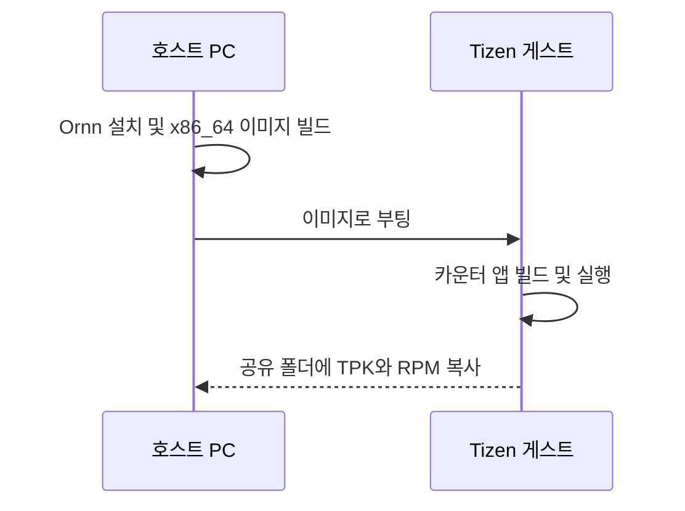

# Tizen Ornn 설치부터 첫 앱 빌드까지

[English](user-guide_en.md)

Windows x64 또는 Ubuntu 24.04 amd64 PC에서 Tizen 10.1 카운터 앱을 만들어 보세요. PC(호스트)에서 개발 이미지를 한 번 만들면, 이후에는 그 이미지로 Tizen(게스트)을 부팅해 앱을 빌드할 수 있습니다.



## 1. 호스트에 Ornn 설치하기

이미지 관리 창을 사용하려면 GUI를, 터미널에서 관리하려면 CLI를 선택하세요. 두 방식 모두 게스트의 Tizen 화면을 열 수 있습니다. [R26 설치 파일과 체크섬](https://github.com/hjhun/tizen-ornn/releases/tag/10.1-r26)

### Windows

쓰기 가능한 폴더에서 `tizen-ornn-windows-x64-portable.exe`를 더블클릭하면 이미지 관리 창이 열립니다. QEMU와 Mesa가 포함되어 있습니다.

PowerShell을 쓰려면 처음 실행한 뒤 생성된 `Tizen Ornn Portable\runtime-…` 폴더를 여세요. 아래 호스트 명령에서 `tizen-ornn` 대신 `.\tizen-ornn.exe`를 사용합니다.

### Ubuntu

다운로드한 폴더에서 원하는 방식 하나를 선택하세요.

**CLI만 설치**

```sh
sudo apt install ./tizen-ornn_amd64.deb
```

**GUI와 CLI 설치**

```sh
sudo apt install ./tizen-ornn_amd64.deb ./tizen-ornn-gui_amd64.deb
tizen-ornn-gui
```

**포터블 GUI 실행**. `.run` 파일은 호스트의 QEMU와 빌드 도구를 사용합니다. 새 Ubuntu에서 의존성도 함께 설치하려면 위의 GUI 패키지 설치 방법을 사용하세요.

```sh
chmod +x tizen-ornn-ubuntu-amd64-portable.run
./tizen-ornn-ubuntu-amd64-portable.run
```

## 2. 호스트에서 개발 이미지 만들기

첫 빌드에는 인터넷 연결이 필요합니다. 게스트의 기본 디스크는 16 GiB이며 루트 파일시스템은 ext4입니다. Windows 빌더는 추가로 메모리 4 GiB와 최대 64 GiB의 임시 희소 디스크를 사용합니다. Ubuntu에서는 일반 사용자로 Ornn을 실행하고 요청 시 sudo 인증을 하세요.

1. **Settings → Work directory**에서 저장 위치를 지정하고 **Save work directory**를 누르세요. Ubuntu와 WSL2에서는 홈 디렉터리 등 Linux 파일시스템을 사용하세요.
2. **Build image…**에서 **x86_64**와 기본 스냅샷을 선택하세요. 이름에 `dev-x86`을 입력하고 **Build**를 누르세요.
3. 빌드가 끝나면 이미지 목록에서 `dev-x86`을 선택하세요. 기존 이미지가 있다면 **Add image…**에서 해당 디렉터리를 열 수 있습니다.

CLI를 사용한다면 다음 명령으로 이미지를 만들고 경로를 확인하세요.

```sh
tizen-ornn build --name dev-x86
tizen-ornn images
```

## 3. 공유 폴더 설정 후 부팅하기

부팅 전에 **Settings → Shared folder (x86_64)**에서 호스트 폴더를 선택하세요. 비워 두면 작업 디렉터리 아래의 `share`를 사용합니다. Ubuntu CLI에서 직접 지정하려면 다음을 실행하세요.

```sh
mkdir -p "$HOME/ornn-share"
tizen-ornn share-dir "$HOME/ornn-share"
```

| 원하는 게스트 화면 | GUI 버튼 | 호스트 명령 |
| --- | --- | --- |
| 카운터 창과 콘솔 | **Start with display** | `tizen-ornn run --gui` |
| 콘솔만 | **Start terminal only** | `tizen-ornn run --headless` |

카운터 창을 보려면 **Start with display**를 선택하세요. 부팅 후 게스트 콘솔에서 계정, 아키텍처, 루트 파일시스템을 확인하세요. 순서대로 `tizen`, `x86_64`, `ext4`가 표시됩니다. 마지막 명령은 공유 폴더의 내용을 보여 줍니다.

```sh
whoami
uname -m
findmnt -n -o FSTYPE /
ls /mnt/host
```

## 4. 게스트에서 카운터 앱 빌드하기

게스트의 `tizen` 계정에서 예제를 빌드하세요. 출력 폴더에 실행 파일 `tizen-ui`와 설치 패키지 `org.example.tizencounter-1.0.0-x86_64.tpk`가 생깁니다.

```sh
cd /usr/share/tizen-dev/examples/efl-counter
./build.sh "$HOME/ornn-build/app"
ls -lh "$HOME/ornn-build/app"
```

그래픽 모드에서는 앱을 실행하고 버튼을 한 번 누르세요. 숫자가 0에서 1로 바뀌면 창을 닫아 콘솔로 돌아오세요.

```sh
tizen-ui-run "$HOME/ornn-build/app/tizen-ui"
```


TPK 설치를 확인하려면 게스트에서 아래 명령을 한 줄씩 입력하세요. `su -`는 root 셸을 열고, `pkginfo`는 앱 등록 정보를 표시합니다. 마지막 `exit`로 `tizen` 계정에 돌아옵니다.

```sh
su -
pkgcmd -i -t tpk -p /home/tizen/ornn-build/app/org.example.tizencounter-1.0.0-x86_64.tpk
pkginfo --app org.example.tizencounter
exit
```

## 5. RPM을 만들고 호스트로 가져오기

같은 x86_64 게스트에서 카운터 앱을 두 아키텍처용으로 빌드하세요. 마지막 명령은 `tizen-ui-counter`의 아키텍처를 각각 `armv7l`과 `x86_64`로 표시합니다.

```sh
cd /usr/share/tizen-dev/examples/efl-counter
./build-rpm.sh x86_64 "$HOME/ornn-build/rpm"
./build-rpm.sh armv7l "$HOME/ornn-build/rpm"
rpm -qp --qf '%{NAME} %{ARCH}\n' "$HOME"/ornn-build/rpm/*.rpm
```

게스트에서 결과물을 공유 폴더로 복사하세요.

```sh
mkdir -p /mnt/host/ornn-results
cp "$HOME"/ornn-build/app/*.tpk "$HOME"/ornn-build/rpm/*.rpm /mnt/host/ornn-results/
ls -lh /mnt/host/ornn-results
```

호스트의 공유 폴더에서 `ornn-results`를 열면 TPK 한 개와 RPM 두 개가 있습니다.

### 선택 사항 · ARMv7용 CMake 프로젝트 테스트

같은 게스트에서 예제를 크로스 빌드하세요. CTest는 `qemu-arm`으로 ARM 실행 파일을 테스트합니다.

```sh
cmake -S /usr/share/tizen-dev/examples/cross-rpm -B "$HOME/build-arm" -G Ninja \
    --toolchain /usr/share/tizen-dev/cmake/armv7l.cmake
cmake --build "$HOME/build-arm"
ctest --test-dir "$HOME/build-arm" --output-on-failure
```

ARM 게스트 자체를 부팅하려면 이미지 빌드에서 `armv7l` 또는 `aarch64`를 선택하세요. R26에서는 ARM 게스트를 재부팅하거나 종료할 때 Enlightenment가 충돌할 수 있습니다.

## 6. 호스트에서 재연결하거나 종료하기

터미널 창을 닫아도 VM과 빌드는 계속 실행됩니다. 같은 콘솔에 돌아가려면 **Open terminal**을 누르세요. CLI에서는 `IMAGE_DIR`을 `tizen-ornn images`에 표시된 경로로 바꿔 실행하세요.

```sh
tizen-ornn console --image-dir "IMAGE_DIR"
```

작업을 마치거나 부팅 모드를 바꾸려면 **Shut down**을 누르거나 다음 명령을 실행하세요. 다음 부팅 때 같은 이미지를 선택하면 됩니다.

```sh
tizen-ornn shutdown --image-dir "IMAGE_DIR"
```

더 읽기: [게스트 개발 예제와 CMake·Rust 빌드](development.md) · [공유 폴더와 VM 실행 옵션](running.md) · [스냅샷 선택과 이미지 빌드](snapshot-build.md)
