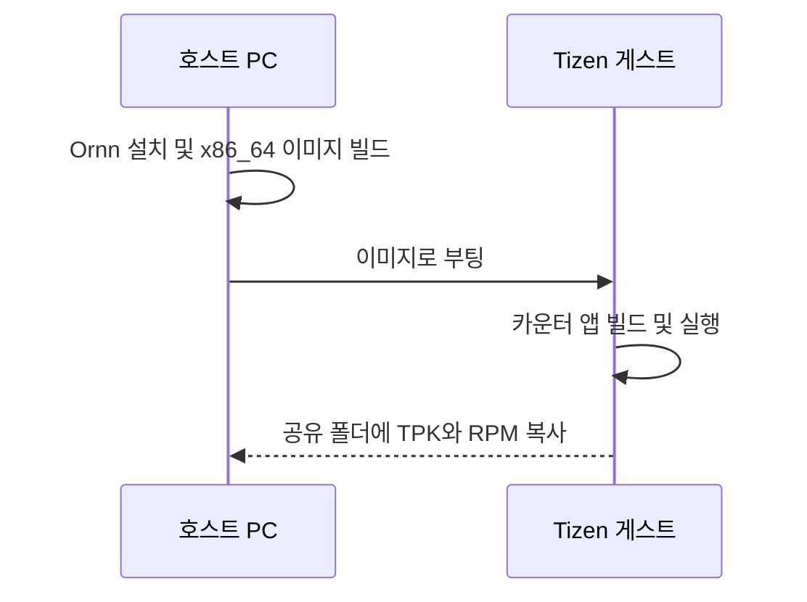
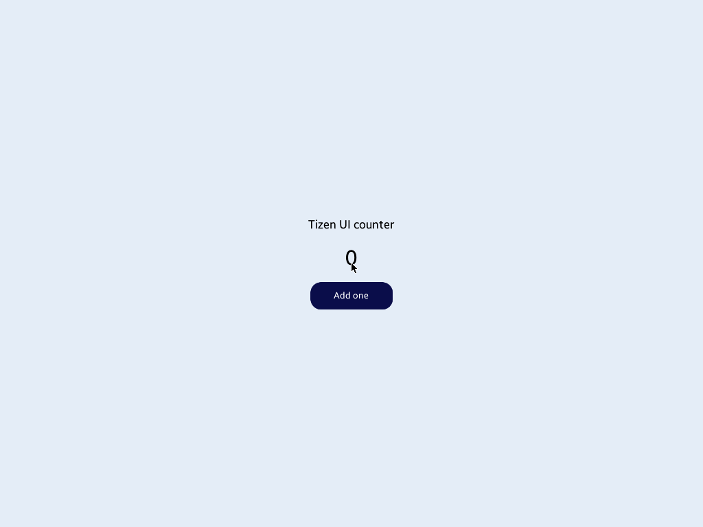

# Tizen Ornn 설치부터 첫 앱 빌드까지

[English](user-guide_en.md)

Windows x64 또는 Ubuntu 24.04 amd64 PC에서 Tizen 10.1 카운터 앱을 만들어 보세요. PC(호스트)에서 개발 이미지를 한 번 만들면, 이후에는 그 이미지로 Tizen(게스트)을 부팅해 앱을 빌드할 수 있습니다.



## 1. 호스트에 Ornn 설치하기

이미지 관리 창을 사용하려면 GUI를, 터미널에서 관리하려면 CLI를 선택하세요. 두 방식 모두 게스트의 Tizen 화면을 열 수 있습니다. [최신 설치 파일과 체크섬](https://github.com/hjhun/tizen-ornn/releases/latest)

### Windows

쓰기 가능한 폴더에서 `tizen-ornn-windows-x64-portable.exe`를 더블클릭하면 이미지 관리 창이 열립니다. QEMU와 Mesa가 포함되어 있습니다.

PowerShell을 쓰려면 처음 실행한 뒤 생성된 `Tizen Ornn Portable\runtime-…` 폴더를 여세요. 아래 호스트 명령에서 `tizen-ornn` 대신 `.\tizen-ornn.exe`를 사용합니다.

### Ubuntu

아래 명령으로 서명된 APT 저장소를 한 번 등록하면 이후에는 `sudo apt update && sudo apt upgrade`로 업데이트할 수 있습니다. CLI만 필요하면 마지막 명령에서 `tizen-ornn-gui`를 생략하세요.

```sh
sudo curl -fsSL https://raw.githubusercontent.com/hjhun/tizen-ornn/main/packaging/apt/tizen-ornn.sources -o /etc/apt/sources.list.d/tizen-ornn.sources
sudo apt update
sudo apt install tizen-ornn tizen-ornn-gui
```

다운로드한 폴더에서 원하는 방식 하나를 선택하세요.

**CLI만 설치**

```sh
sudo apt install ./tizen-ornn_amd64.deb
```

**GUI와 CLI 설치**

```sh
sudo apt install ./tizen-ornn_amd64.deb ./tizen-ornn-gui_amd64.deb
tizen-ornn-gui
```

**포터블 GUI 실행**. `.run` 파일은 호스트의 QEMU와 빌드 도구를 사용합니다. 한국어 표시에는 호스트의 `fonts-noto-cjk`가 필요합니다. 위의 GUI 패키지 설치 방법을 사용하면 이 글꼴과 의존성도 함께 설치됩니다.

```sh
chmod +x tizen-ornn-ubuntu-amd64-portable.run
./tizen-ornn-ubuntu-amd64-portable.run
```

## 2. 호스트에서 개발 이미지 만들기

첫 빌드에는 인터넷 연결이 필요합니다. 게스트의 기본 디스크는 16 GiB이며 루트 파일시스템은 ext4입니다. Windows 빌더는 추가로 메모리 4 GiB와 최대 64 GiB의 임시 희소 디스크를 사용합니다. Ubuntu에서는 일반 사용자로 Ornn을 실행하고 요청 시 sudo 인증을 하세요.

**Settings → Language → 한국어**를 선택하면 메뉴와 경로 탐색기가 한국어로 표시됩니다. 다음 실행에도 선택한 언어를 사용합니다.

1. **설정 → 작업 폴더 → 찾아보기…**에서 저장 위치를 선택하고 **작업 폴더 저장**을 누르세요. Ubuntu와 WSL2에서는 홈 디렉터리 등 Linux 파일시스템을 사용하세요.
2. **Build image…**에서 기본 스냅샷을 사용하세요. 이름에 `dev-x86`을 입력하고 **Build**를 누르세요.
3. 빌드가 끝나면 이미지 목록에서 `dev-x86`을 선택하세요. 기존 이미지가 있다면 **Add image…**에서 해당 디렉터리를 열 수 있습니다.

CLI를 사용한다면 다음 명령으로 이미지를 만들고 경로를 확인하세요.

```sh
tizen-ornn build --name dev-x86
tizen-ornn images
```

정지된 x86_64 이미지를 선택하고 **Update image**를 누르면 최신 스냅샷을 확인합니다. 새 이미지에서도 같은 공유 폴더가 `/home/tizen/share`에 연결됩니다. 예전에 호스트와 공유하던 홈 파일은 이제 `~/share`에 있습니다. 필요한 프로젝트나 설정 파일을 게스트 홈으로 복사하세요.

## 3. 공유 폴더 설정 후 부팅하기

부팅 전에 **설정 → 공유 폴더 (x86_64) → 찾아보기…**에서 호스트 폴더를 선택하고 **공유 폴더 저장**을 누르세요. 비워 두면 작업 디렉터리 아래의 `share`를 사용합니다. Ubuntu CLI에서 직접 지정하려면 다음을 실행하세요.

```sh
mkdir -p "$HOME/ornn-share"
tizen-ornn share-dir "$HOME/ornn-share"
```

| 원하는 게스트 화면 | GUI 버튼 | 호스트 명령 |
| --- | --- | --- |
| 카운터 창과 콘솔 | **Start with display** | `tizen-ornn run --gui` |
| 콘솔만 | **Start terminal only** | `tizen-ornn run --headless` |

카운터 창을 보려면 **Start with display**를 선택하세요. 부팅 후 게스트 콘솔에서 계정, 아키텍처, 루트 파일시스템을 확인하세요. 순서대로 `tizen`, `x86_64`, `ext4`가 표시됩니다. 마지막 명령은 공유 폴더의 내용을 보여 줍니다.

```sh
whoami
uname -m
findmnt -n -o FSTYPE /
ls /mnt/host
```

### 호스트에서 SDB 셸 열기

호스트의 PATH에 Tizen Studio의 `sdb`가 있으면 x86_64 VM이 부팅될 때 자동으로 연결됩니다. 호스트에서 `sdb devices`를 실행하고 첫 열의 값을 복사하세요. 아래는 포트가 33767인 예입니다. 포트는 부팅할 때마다 달라질 수 있습니다.

```sh
sdb devices
sdb -s 127.0.0.1:33767 shell
```

연결된 장치가 하나면 `sdb shell`로도 들어갈 수 있습니다. SDB를 VM 부팅 후 설치했다면 Ornn 콘솔에 표시된 주소로 `sdb connect 127.0.0.1:33767`을 한 번 실행하세요.

## 4. 게스트에서 카운터 앱 빌드하기

게스트의 `tizen` 계정에서 예제를 빌드하세요. 출력 폴더에 실행 파일 `tizen-ui`와 설치 패키지 `org.example.tizencounter-1.0.0-x86_64.tpk`가 생깁니다.

```sh
cd /usr/share/tizen-dev/examples/efl-counter
./build.sh "$HOME/ornn-build/app"
ls -lh "$HOME/ornn-build/app"
```

그래픽 모드에서는 앱을 실행하고 버튼을 한 번 누르세요. 숫자가 0에서 1로 바뀌면 창을 닫아 콘솔로 돌아오세요.

```sh
tizen-ui-run "$HOME/ornn-build/app/tizen-ui"
```



TPK 설치를 확인하려면 게스트에서 아래 명령을 한 줄씩 입력하세요. `su -`는 root 셸을 열고, `pkginfo`는 앱 등록 정보를 표시합니다. 마지막 `exit`로 `tizen` 계정에 돌아옵니다.

```sh
su -
pkgcmd -i -t tpk -p /home/tizen/ornn-build/app/org.example.tizencounter-1.0.0-x86_64.tpk
pkginfo --app org.example.tizencounter
exit
```

## 5. RPM을 만들고 호스트로 가져오기

같은 x86_64 게스트에서 카운터 앱을 두 아키텍처용으로 빌드하세요. 마지막 명령은 `tizen-ui-counter`의 아키텍처를 각각 `armv7l`과 `x86_64`로 표시합니다.

```sh
cd /usr/share/tizen-dev/examples/efl-counter
./build-rpm.sh x86_64 "$HOME/ornn-build/rpm"
./build-rpm.sh armv7l "$HOME/ornn-build/rpm"
rpm -qp --qf '%{NAME} %{ARCH}\n' "$HOME"/ornn-build/rpm/*.rpm
```

게스트에서 결과물을 공유 폴더로 복사하세요.

```sh
mkdir -p /mnt/host/ornn-results
cp "$HOME"/ornn-build/app/*.tpk "$HOME"/ornn-build/rpm/*.rpm /mnt/host/ornn-results/
ls -lh /mnt/host/ornn-results
```

호스트의 공유 폴더에서 `ornn-results`를 열면 TPK 한 개와 RPM 두 개가 있습니다.

### 선택 사항 · ARMv7용 CMake 프로젝트 테스트

같은 게스트에서 예제를 크로스 빌드하세요. CTest는 `qemu-arm`으로 ARM 실행 파일을 테스트합니다.

```sh
cmake -S /usr/share/tizen-dev/examples/cross-rpm -B "$HOME/build-arm" -G Ninja \
    --toolchain /usr/share/tizen-dev/cmake/armv7l.cmake
cmake --build "$HOME/build-arm"
ctest --test-dir "$HOME/build-arm" --output-on-failure
```

RPM spec과 소스가 있는 디렉터리에서 x86_64 게스트의 `ornn build --target armv7l` 또는 `ornn build --target aarch64`로 해당 아키텍처의 RPM을 생성할 수 있습니다.

Git 체크아웃 루트에서 `ornn build`를 실행하면 기본으로 x86_64 RPM을 빌드합니다. Git이 추적하는 spec에서 로컬 `Source0: %{name}-%{version}.tar.gz`를 선언하고 해당 파일이 없으면, Ornn이 추적 중인 파일의 현재 내용으로 임시 압축 파일을 만듭니다. 새 소스 파일은 `git add`로 포함하세요. 기존 압축 파일과 추가 manifest는 그대로 사용합니다.

Ornn은 빌드할 때마다 `/home/tizen/share/build/<프로젝트>/<대상>/run.*/`에 결과를 보관합니다. 호스트에서 `build.log`, `BUILD/` 안의 CMakeCache.txt와 CTest 로그, `BUILDROOT/`, `RPMS/`를 열 수 있습니다. 실패한 빌드도 보존합니다. 공유 폴더에서 빌드 도구를 실행할 수 없으면 게스트 디스크에서 빌드한 뒤 공유 폴더로 복사하고, 공유 폴더가 표현할 수 없는 파일은 `work.tar`에도 보관합니다. 체크아웃에서 `ornn clean`을 실행하면 해당 프로젝트의 빌드 기록 디렉터리와 RPM을 삭제합니다.

어느 디렉터리에서든 `ornn install 이름`을 실행하면 해당 프로젝트의 마지막 성공 빌드에서 호환되는 RPM과 필요한 로컬 서브패키지를 먼저 설치합니다. 버전이 같아도 내용이 달라졌으면 교체합니다. 로컬 후보가 없고 설치되지 않은 패키지는 게스트의 Zypper 저장소에서 가져옵니다. `ornn uninstall 이름`은 게스트에서 지정한 패키지만 제거하며, 다른 패키지가 의존하면 제거를 중단합니다.

빌드 의존성 설치, `install`, `restore`에서 사용할 원격 RPM-MD 저장소는 `~/.ornn.conf`에 URL 순서대로 적습니다. 위쪽 저장소의 우선순위가 높습니다. 이미지에 고정된 스냅샷 URL은 `zypper repos --uri`로 확인할 수 있고, 게스트가 신뢰하는 서명된 저장소도 지정할 수 있습니다.

```ini
[repos]
url = https://repository.example/team/
url = https://repository.example/platform/
```

기본 네이티브 빌드는 생성한 RPM을 게스트에 즉시 설치합니다. 예를 들어 `bundle`에서 `ornn build`를 실행하고 `rpc-port`에서 빌드하면 새 헤더와 라이브러리를 사용합니다. 패키지만 만들려면 `ornn build --no-install`을 사용하세요. 프로젝트 루트에서 `ornn restore`를 실행하면 마지막으로 설치한 패키지를 서버 버전으로 복원합니다. 목록은 `${XDG_DATA_HOME:-~/.local/share}/ornn/projects/<키>/.installed-rpms`에 저장되므로 `ornn clean` 뒤에도 복원할 수 있습니다. 특정 패키지만 복원하려면 `ornn restore bundle bundle-devel`을 사용하세요.

프로젝트 루트에서 `ornn status`를 실행하면 마지막 빌드와 게스트 설치본의 RPM 식별값을 비교합니다. `different`는 두 파일이 다르다는 뜻입니다. 설치가 중단되면 같은 패키지 세트를 다시 빌드하거나 `ornn restore`로 복구하세요.

## 6. 호스트에서 재연결하거나 종료하기

터미널 창을 닫아도 VM과 빌드는 계속 실행됩니다. 같은 콘솔에 돌아가려면 **Open terminal**을 누르세요. CLI에서는 `IMAGE_DIR`을 `tizen-ornn images`에 표시된 경로로 바꿔 실행하세요.

```sh
tizen-ornn console --image-dir "IMAGE_DIR"
```

작업을 마치거나 부팅 모드를 바꾸려면 **Shut down**을 누르거나 다음 명령을 실행하세요. 다음 부팅 때 같은 이미지를 선택하면 됩니다.

```sh
tizen-ornn shutdown --image-dir "IMAGE_DIR"
```

더 읽기: [게스트 개발 예제와 CMake·Rust 빌드](development.md) · [공유 폴더와 VM 실행 옵션](running.md) · [스냅샷 선택과 이미지 빌드](snapshot-build.md)

### 사내 CA 인증서로 이미지 빌드

**Settings → Build CA certificate → Browse…**에서 PEM 형식의 공개 CA
인증서(`.crt`)를 선택하고 **Save certificate**를 누릅니다. 저장한 경로는
GUI와 CLI에서 새 이미지를 빌드할 때 환경변수 `TIZEN_BUILD_CA_CERT`보다
우선합니다. 입력란을 비우고 저장하면 환경변수 경로를 사용합니다.
[HTTPS 인증서 안내](https-certificates.md)

### 다운로드 및 빌드 프록시

**Settings → Build proxy**의 기본값은 **System settings**입니다.
`http_proxy`, `https_proxy`, `all_proxy`, `no_proxy` 환경변수를 우선하며,
프록시 주소 환경변수가 없으면 Ubuntu의 GNOME 또는 Windows의 고정 프록시
설정을 읽습니다. **Manual proxy**를 선택하면 HTTP·HTTPS 요청에 사용할 주소와
프록시를 거치지 않을 호스트 목록(쉼표 구분)을 지정할 수 있습니다.
**Save proxy**로 저장하면 다음 Ornn 다운로드와 이미지 빌드부터 적용됩니다.
시스템 설정으로 돌아가려면 **System settings → Save proxy**를 누르세요.
