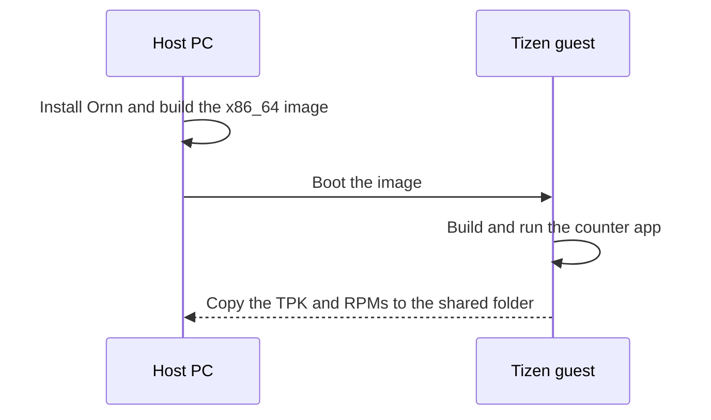
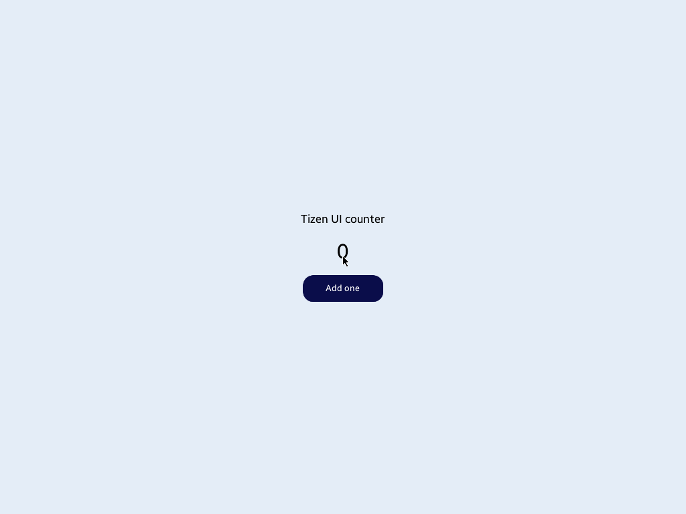

# From installing Tizen Ornn to building your first app

[한국어](user-guide.md)

Build a Tizen 10.1 counter app on a Windows x64 or Ubuntu 24.04 amd64 PC. Create the development image once on your PC (the host). Each time you work on the app, boot Tizen (the guest) from that image.



## 1. Install Ornn on the host

Choose the GUI to manage images in a window, or the CLI to manage them in a terminal. Both can open the Tizen guest display. [R26 downloads and checksums](https://github.com/hjhun/tizen-ornn/releases/tag/10.1-r26)

### Windows

Double-click `tizen-ornn-windows-x64-portable.exe` in a writable folder to open the image library. The executable includes QEMU and Mesa.

For PowerShell, open the `Tizen Ornn Portable\runtime-…` folder created on first launch. Use `.\tizen-ornn.exe` for the host commands shown as `tizen-ornn` below.

### Ubuntu

In the download directory, choose one setup.

**CLI only**

```sh
sudo apt install ./tizen-ornn_amd64.deb
```

**GUI and CLI**

```sh
sudo apt install ./tizen-ornn_amd64.deb ./tizen-ornn-gui_amd64.deb
tizen-ornn-gui
```

**Portable GUI**. The `.run` file uses the host’s QEMU and build tools. On a fresh Ubuntu system, the GUI package installation above also installs those dependencies.

```sh
chmod +x tizen-ornn-ubuntu-amd64-portable.run
./tizen-ornn-ubuntu-amd64-portable.run
```

## 2. Build the development image on the host

The first build needs internet access. The guest defaults to a 16 GiB disk with an ext4 root filesystem. On Windows, the builder also uses 4 GiB of RAM and a temporary sparse disk of up to 64 GiB. On Ubuntu, run Ornn as your regular user and enter your sudo password when prompted.

1. Set the storage location in **Settings → Work directory** and click **Save work directory**. On Ubuntu and WSL2, use a Linux filesystem such as your home directory.
2. Open **Build image…**. Choose **x86_64** and the default snapshot. Name the image `dev-x86` and click **Build**.
3. When the build finishes, select `dev-x86` in the library. To use an existing image, open its directory with **Add image…**.

From the CLI, build the image and list its path.

```sh
tizen-ornn build --name dev-x86
tizen-ornn images
```

## 3. Set up the shared folder and boot Tizen

Before boot, choose a host folder in **Settings → Shared folder (x86_64)**. Leave it blank to use `share` under the work directory. To set a folder from the Ubuntu CLI, run these commands.

```sh
mkdir -p "$HOME/ornn-share"
tizen-ornn share-dir "$HOME/ornn-share"
```

| Guest display | GUI button | Host command |
| --- | --- | --- |
| App window and console | **Start with display** | `tizen-ornn run --gui` |
| Console only | **Start terminal only** | `tizen-ornn run --headless` |

Choose **Start with display** to see the counter window. In the guest console, the first three commands should print `tizen`, `x86_64`, and `ext4`, respectively. The last command lists the shared folder.

```sh
whoami
uname -m
findmnt -n -o FSTYPE /
ls /mnt/host
```

## 4. Build the counter app in the guest

As the guest user `tizen`, build the sample. The output directory should contain the executable `tizen-ui` and the installable package `org.example.tizencounter-1.0.0-x86_64.tpk`.

```sh
cd /usr/share/tizen-dev/examples/efl-counter
./build.sh "$HOME/ornn-build/app"
ls -lh "$HOME/ornn-build/app"
```

In graphical mode, run the app and press the button once. When the count changes from 0 to 1, close the window to return to the console.

```sh
tizen-ui-run "$HOME/ornn-build/app/tizen-ui"
```



To check the TPK installation, enter the commands below one at a time. In the guest, `su -` opens a root shell, `pkginfo` shows the app registration, and `exit` returns to `tizen`.

```sh
su -
pkgcmd -i -t tpk -p /home/tizen/ornn-build/app/org.example.tizencounter-1.0.0-x86_64.tpk
pkginfo --app org.example.tizencounter
exit
```

## 5. Build RPMs and copy the packages to the host

Build the counter for both architectures in the same x86_64 guest. The last command lists two `tizen-ui-counter` packages, one for `armv7l` and one for `x86_64`.

```sh
cd /usr/share/tizen-dev/examples/efl-counter
./build-rpm.sh x86_64 "$HOME/ornn-build/rpm"
./build-rpm.sh armv7l "$HOME/ornn-build/rpm"
rpm -qp --qf '%{NAME} %{ARCH}\n' "$HOME"/ornn-build/rpm/*.rpm
```

In the guest, copy the packages to the shared folder.

```sh
mkdir -p /mnt/host/ornn-results
cp "$HOME"/ornn-build/app/*.tpk "$HOME"/ornn-build/rpm/*.rpm /mnt/host/ornn-results/
ls -lh /mnt/host/ornn-results
```

On the host, open `ornn-results` in the shared folder to find one TPK and two RPMs.

### Optional exercise: test a CMake project for ARMv7

Cross-compile the sample in the same guest. CTest runs the ARM binary with `qemu-arm`.

```sh
cmake -S /usr/share/tizen-dev/examples/cross-rpm -B "$HOME/build-arm" -G Ninja \
    --toolchain /usr/share/tizen-dev/cmake/armv7l.cmake
cmake --build "$HOME/build-arm"
ctest --test-dir "$HOME/build-arm" --output-on-failure
```

To boot an ARM guest, choose `armv7l` or `aarch64` in the image builder. On R26, Enlightenment can crash when an ARM guest reboots or shuts down.

## 6. Reconnect or shut down from the host

Closing the terminal leaves the VM and its builds running. Choose **Open terminal** to rejoin the console. For the CLI, replace `IMAGE_DIR` with the path from `tizen-ornn images`.

```sh
tizen-ornn console --image-dir "IMAGE_DIR"
```

When you finish or need to change display modes, choose **Shut down** or run the command below. Select the same image the next time you boot.

```sh
tizen-ornn shutdown --image-dir "IMAGE_DIR"
```

Further reading: [VM operation and shared folders](running.md) · [Guest examples, CMake and Rust (Korean)](development.md) · [Snapshot selection and image builds (Korean)](snapshot-build.md)

### Building an image with a private CA

Open **Settings → Build CA certificate → Browse…**, select your public PEM
CA certificate (`.crt`), and click **Save certificate**. The GUI and CLI use
the saved file for new image builds. Clear the field and save to fall back
to `TIZEN_BUILD_CA_CERT`. [HTTPS certificate guide](https-certificates.md)

### Download and build proxy

In **Settings → Build proxy**, **System settings** uses the inherited HTTP,
HTTPS, ALL and NO_PROXY environment variables (lowercase first), then the
desktop's static proxy settings on Windows or GNOME when no proxy endpoint
variable is set. WSL can also read Windows settings. Choose **Manual proxy**
to specify one HTTP(S) proxy for both protocols and a comma-separated bypass
list. Click **Save proxy**. Select **System settings** and save to reset.
Manual addresses accept a hostname and optional port. Use the environment
for proxy credentials. PAC/WPAD and the Windows `<local>` bypass pattern
are outside the static proxy configuration supported by the builder.

The setting applies to the Ornn CLI and GUI, including the temporary Windows
builder VM and build-time Tizen package downloads. Running guest applications
use their normal runtime settings.
